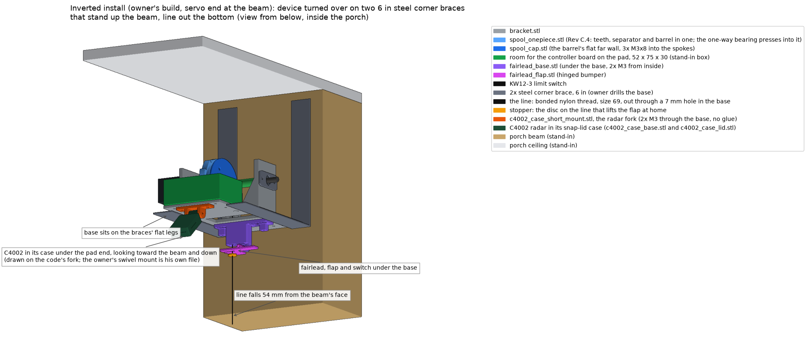

# DropSpider

**A Halloween prop that drops a foam spider on people walking up to the door, winds it back up and waits for the next one.** This is Mechanism A, the in-line single-axle clutch spool, Rev C.1. A stepper motor, a one-way bearing, a servo-driven ratchet finger and a 24 GHz mmWave radar, all on an ESP32, in a 3D printed bracket that sits upside down on two steel corner braces on the porch beam. Drops 0.5 to 1.2 m. Draws almost nothing while it waits.

Code and files: https://github.com/Maestro8484/DropSpider-inline. Project page: https://theschmidtwithin.com/bench/#dropspider

The name `dropspider-tiltspool` is saved for Mechanism B (a servo tilts the spool and the spider free-falls). Not started. This is Mechanism A only.

The drawing shows the Rev C.4 spool and the C4002 in its case on the code's fork; my own swivel mount (doc 02, doc 06) is a Fusion file, so the fork stands in for it. Photos and a video of the real thing dropping are coming.

<!-- video and photos go here: a link to the clip and two or three pictures of the device on the porch -->

## How it works

The stepper turns a 6 mm rod through a coupler. The spool rides the rod on a one-way bearing (the HF0612, a needle clutch). On a drop the motor spins fast in the unwind direction and the spool runs down behind it: the clutch lets the spool lag but never pass the motor, so the motor sets how fast the spider falls and where it stops. On the rewind the clutch locks and the motor winds the spider home. A small stopper on the line lifts a hinged flap under the base and clicks a limit switch, so the board knows the spider is home. Then a servo swings a finger into the spool's ratchet teeth, the motor and servo switch off, and the finger holds the spider with no power.

The trigger is a DFRobot C4002 mmWave radar on the device, looking out from under the porch. It reports how far away someone is and how fast they're coming. The drop fires only on someone walking toward the door, close enough that the spider lands as they get there. Walking away, walking past, or standing still does nothing.

Everything is run from the board's own web page on your phone: drop it, bring it home, set the drop length, read the radar, update the firmware.

## What's in here

Each file has one job. A **handoff** is work still to do, written so someone can pick it up cold. Finished work goes in the **changelog**. Problems and unknowns go in the **issues** list. Bench results go in the **log**. Everything else says how the device is now.

| Path | What |
|---|---|
| `docs/build_guide/build_guide.html` | **start here to build one:** one page, wiring to arming, with pictures. `build_guide.src.html` is its source; `python tools\make_build_guide.py` rebuilds the page |
| `docs/01_mechanical_design.md` | the design: parts on the rod, the lock, which way things turn, print settings |
| `docs/02_electrical.md` | pin map, power, driver setup, the radar's wiring |
| `docs/03_sensor.md` | the C4002 radar: why, where it sits, the trigger rule, its own settings (the parked LD2450 at the bottom, for the record) |
| `docs/04_firmware.md` | what the firmware does, how to load it, every command, the web page, the firmware version |
| `docs/05_assembly.md` | assembly step by step, with pictures |
| `docs/06_installation.md` | the porch: heights, the braces, the line length, safety. Ceiling install first, the inverted install (the one I'm building) below it |
| `docs/07_commissioning.md` | the bench checklist, each step with its pass mark |
| `docs/08_open_items.md` | **issues:** what's proven, what isn't, what could stop the build; closed items one line each |
| `docs/09_fairlead_switch.md` | the fairlead, the hinged flap and the KW12-3 limit switch, both installs |
| `docs/wiring_guide.html` | the wiring as one printable page |
| `docs/commissioning_log.md` | **log:** every bench result, dated, failures included |
| `docs/M1_fix_handoff.md` | reference: why the Rev C clutch was backwards, the Rev C.1 fix, and the bench tests T1 to T8 (the name is old; it's not a handoff any more) |
| `docs/audit_spider_runaway.md` | reference: why the spider used to run away on every downward move, and what fixed it |
| `docs/audit_webui_horizon.md` | reference: the web page audit of 2026-10-14 and the rulings that came out of it |
| `docs/handoff_task1_firmware.md` | **handoff:** the bench tests T1 to T8 with the mechanism assembled |
| `docs/handoff_sensor_bearings.md` | **handoff:** finish the radar bench (walk tests S2 to S5) and carry the numbers to the porch. The name is old |
| `docs/handoff_flash11_page_sleep_led.md` | **handoff:** flash 11 onto the board and watch each new thing work |
| `ROADMAP.md` | **roadmap:** everything still to do, in order, one line each |
| `CHANGELOG.md` | **changelog:** finished work, newest first |
| `cad/generate.py`, `cad/fairlead.py`, `cad/inverted.py`, `cad/c4002_case.py` | every printed part is Python; `cad/README.md` says how. `docs/diagrams.py` draws the wiring and install pictures |
| `cad/stl/` | the print files. The `.3mf` files beside them are my own Bambu Studio projects. `cad/retired/` and `docs/retired/` hold old parts and docs: don't print or follow those |
| `platformio.ini`, `src/`, `include/` | the firmware, standard PlatformIO layout, for a 30-pin ESP32 DevKit V1 (the 38-pin NodeMCU-32S works too) |
| `secrets.ini.example` | copy to `secrets.ini` and fill in your WiFi name, password and update password. `secrets.ini` never goes to GitHub |
| `bom/BOM.csv` | every part, where it came from |
| `scripts\update_firmware.bat` | double-click to put the firmware on the board, by WiFi or by USB |
| `scripts\check_repo.bat` | double-click to check the files: passwords kept out, every doc on this map, no dead links, every named STL present, the firmware version clean, and (option 2) a full firmware build |
| `tools/` | the helpers the two .bat files use, plus `console.py` (send a command, read the reply) and `regen_cad.ps1` (rebuild every STL and picture; mine to run) |

## Build one

1. Print the parts in `cad/stl/` (which ones and how: doc 01 and the build guide, section 01).
2. Buy what's on the TO BUY lines in `bom/BOM.csv`.
3. Wire it per the build guide, sections 02 to 05. Meter the 5 V buck first (4.95 to 5.05 V) and set the driver to 0.85 V before the motor goes on.
4. On a fresh PC: install VS Code and its PlatformIO extension. Get the files (Download ZIP on GitHub, or `git clone`). Copy `secrets.ini.example` to `secrets.ini` and put in your WiFi name and password.
5. Plug the board in by USB and double-click `scripts\update_firmware.bat`, pick 2. It builds the firmware and loads it. The board's web page then shows the version it runs on the Status card.
6. Assemble per doc 05 and the build guide, section 06.
7. Power up one layer at a time (build guide, section 07), then run the bench steps in doc 07 from the web page at `http://dropspider.local`.
8. Hang it per doc 06 and the build guide, sections 11 and 12. From then on firmware updates go over WiFi.

## Firmware version

Every build is stamped with a version read from git, shown in the boot log, in `status` and on the page's Status card. `fw-11` means exactly the eleventh build that went on the board; `fw-10+3.f6a9849` means three changes past the tenth. A star on the end means the firmware had unsaved edits when it was built, and `unknown` means it was built from a ZIP, not a git copy. Details in doc 04.

## Where it stands

The mechanism, the firmware and the radar are built and running on the bench, over the inside of my front door: about 190 drops so far, radar-fired, each one winding home to the switch and locking. What's left is on the roadmap: the last radar walk tests, hanging it on the porch, and a few page refinements waiting for their flash. The bench log has every result, failures included.

## License

MIT for all of it, firmware, tools, CAD, printed parts and docs, by Joe Schmidt. The one exception is the C4002 radar case, drawn after a MakerWorld enclosure and carrying its CC BY-NC-SA terms. All of it in `LICENSE`.
