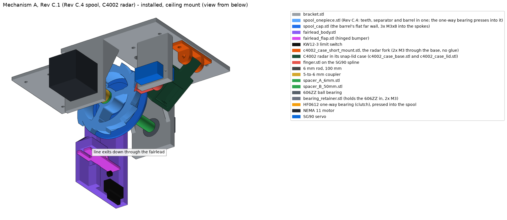
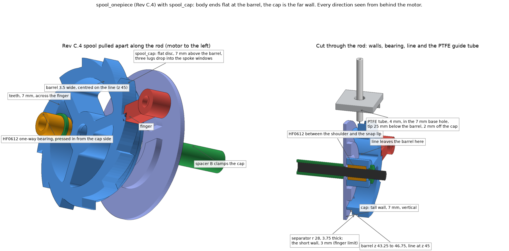

# 01 - Mechanical design: Mechanism A, In-Line Single-Axle Clutch Spool (ISCS), Rev C.1

Status: **released for build, Rev C.1** (clutch flipped, motor-led drop; see `M1_fix_handoff.md`). Owner: lead mechanical engineer. Source of truth for geometry: `cad/generate.py`.

## What it does, in one paragraph

A foam spider (about 13 g, brought to about 30 g with added weight) hangs on bonded nylon thread wound on a spool. The spool sits on a one-way clutch bearing (HF0612) on a steel rod driven by a small stepper motor. A servo-held finger locks the spool at the top with zero power. On trigger, the motor winds a hair to lift the tooth off the finger, the finger swings out, and the motor spins fast in the unwind direction. The spool runs down behind it on the clutch: it can fall as fast as gravity allows but never faster than the motor, so the motor sets the top speed and the stopping point. After a short hang, the motor winds the spool back up (the clutch locks in that direction), the finger swings back into the ratchet teeth, the motor eases the spool down onto a tooth, and everything powers down.

## Why this layout (decisions already made, do not re-open without cause)

| Decision | Reason |
|---|---|
| Spool on a one-way clutch, motor-led drop (Rev C.1) | A one-way clutch only lets the spool overrun in the direction the motor drives, so the spool cannot free-fall past a stopped motor (flaw M1 in Rev C). Instead the motor runs ahead in the unwind direction; the spool lags behind it at gravity and can never overrun it. The unpowered motor's drag (measured too high) never matters because the motor is always driven. |
| Everything on one rod ("in-line") | Strength and simplicity: no gears, belts, or offset shafts. One part to align. |
| Ratchet + servo finger for the hold | Zero power while armed, no hum, no heat. The load pushes the finger onto a printed ledge, not into the servo. |
| Stepper, not a DC gearmotor | Fixed step count per move; the fairlead's limit switch marks home. |
| Hard stop at the top = bead lifts a hinged flap under the fairlead, which presses a KW12-3 switch; the flap then bottoms on the fairlead (Rev C.1, doc 09) | Rewind length varies by up to half a turn after each drop (see "End of drop"), so a counted stop alone is not reliable. |
| Spool is one body plus a flat cap (Rev C.4) | Both print flat with zero supports and no screws; the separate cap gives a vertical far wall 7 mm tall, which a one-piece part could only print as a ramp. |

## Parts on the rod, motor to bearing (z = distance from the motor plate's outer face)

| z (mm) | Part | Notes |
|---|---|---|
| -32 to 0 | NEMA 11 motor | Mounted on the outside of the motor plate, 4x M2.5 |
| 10 to 30 | 5-to-6 mm rigid coupler | Motor shaft fills the 5 mm side. Blue Loctite on both set screws. |
| 20 to 120 | 6 mm hardened rod, 100 mm | Clamped in the coupler only; everything else slides on it |
| 30 to 36 | spacer_A_6mm | 12 mm across, so it stops on the ratchet disk's face instead of dropping into its 10.3 mm center hole. Sets the disk in the finger plane. Adjust with shims (see below). |
| 36 to 43 | spool_ratchet | 12 teeth, full 7 mm (tip r 33, root r 29); a plain plate, flat both faces. The finger engages z 36 to 42, so the shield on the z 43 face clears the finger by 1 mm |
| 43 to 44.5 | spool_shield | Flat 1.5 mm disc, 64 mm across like the spool flange: keeps the line off the teeth. Clears the finger's top (z 42) by 1 mm |
| 44.5 to 50 | spool_body with HF0612 pressed in | Flat face on the shield; line channel z 44.5 to 48. The HF0612 (z 38 to 50) runs through all three parts and centres them; 3x M3x8 from the motor side, heads 5 deep in the disk |
| 50 to 100 | spacer_B_50mm | 9.6 mm across; the last 1 mm at the 606ZZ end is 8 mm across so it presses only on the bearing's inner ring, not its shield |
| 100 to 106 | 606ZZ in the bearing plate | Supports the rod end |

**The one measurement that matters:** the ratchet disk must straddle the finger. Finger plate is z 35 to 42 (7 mm thick); disk is z 36 to 42. After the motor and coupler are on, measure from the motor plate's outer face to the coupler's free end. If it is not 30 mm, change spacer A by the difference using `shim_1mm` / `shim_2mm` (or reprint spacer A). The spool floats between spacer A and spacer B, so the stack must be snug, not tight.

### Rev C.4 spool: one-piece body plus cap (`spool_onepiece.stl` and `spool_cap.stl`, designed 2026-10-04, REPO-ONLY)

Replaces the three-part stack above, and the Rev C.3 one-piece, once printed and checked. Two printed parts, no screws, no glue: the body (teeth, separator and barrel in one piece, 14.25 mm long) and a flat cap that is the far wall (2.0 mm). Together 16.25 mm, z 32.5 to 48.75. Drawn with the shorter-hub finger (plate z 32.5 to 39.5). Status: checked in the model only; nothing printed, nothing benched.

Why it changed (owner 2026-10-04): on the Rev C.3 one-piece the line came off the far (606ZZ) side, over its 2 mm far wall, which was a 45 degree ramp, and wound onto the rod and spacer. The line's feed point (where it leaves the spool toward the base hole, z 45) had landed on that ramp, 0.5 mm past the barrel. Rev C.4 centres the barrel on the feed point and makes the far wall a vertical cap 7 mm tall.

| z (mm) | Part | Notes |
|---|---|---|
| 32.5 to 39.5 | teeth | Same 12 teeth (tip r 33, root r 29), 7 mm deep, straight across the finger plate |
| 39.5 to 43.25 | separator | r 28, 3.75 thick (C.3: 1.5), 1.4 mm inside the finger's closest point (r 29.4), so the finger never touches it however the stack is shimmed (checked slid 5 mm either way) |
| 43.25 to 46.75 | barrel, r 25, 3.5 wide | Centred on the line's feed point, z 45, with 1.75 mm to spare each side. Line hole printed in at z 45.0 (1.2 mm teardrop, at 60 degrees, between two spokes, leaning the way the line wraps). The body ends flat at the barrel's far edge (C.3 was 14.5 long, with the ramp and rim) |
| 46.75 to 48.75 | `spool_cap` | Flat disc r 32 (64 mm across), 2.0 thick: the far wall stands 7 mm above the barrel and is vertical. Centre hole 7.0, chamfered both faces. Three lugs 3 mm deep on its line-side face drop into the body's three spoke windows |
| 34.15 to 46.04 | HF0612 (9.99 across, 11.89 long, owner measured) | Plain 10.2 hole, 12.0 long, between a printed shoulder on the motor side and a snap lip at the body's far face (9.9 across, 0.3 deep, with a 45 degree ramp above it). Press in from the far face past the lip until it stops on the shoulder, before the cap goes on; then it cannot walk out either way. `spool_onepiece_ribs.stl`: 10.4 hole with six crush ribs reaching to 10.0, same shoulder and lip |

The cap (`spool_cap.stl`): each lug is the shape of a spoke window shrunk 0.4 mm all round and kept to r 11 to 19 (205 mm2 each), so the cap turns with the body (1.5 degrees of play before a lug meets a spoke). Its line-side face sits on the body's far face over 634 mm2. Nothing holds it on but the stack: spacer B (or the shim against the spool) clamps it, bearing on 25 mm2 of the cap's outer face round the hole. Prints outer face down, lugs up, 5.0 mm tall, no supports. The 0.4 mm lug gap is drawn; printed windows come out 0.1 to 0.2 mm small a side, so expect a snug drop-in; if a lug will not go, a stroke of a file on the lug's side. The cap closes the far ends of the spoke windows, so the line is anchored through the hole BEFORE the cap goes on (doc 05 section B); the windows stay open on the motor face for fishing the line out.

Stack on the owner's build, as a change from the C.3 one-piece: motor side unchanged, `spacer_A_nose_7_5mm` alone (12 mm on the coupler, last 1 mm 8 mm across, nose to the spool; his 6 mm spacer A plus 4 mm shim, less 2.5 mm for the shorter-hub finger; 2.5 mm from the coupler's end at z 30 in the model). The nose bears on the spool's face close to the rod (hole 7.0, so a ring r 3.7 to 4.0), a small rubbing radius while the spool freewheels. 606ZZ side: spacer B and its shims fill 51.25 mm (z 48.75 to 100; C.3 needed 53.0), so 1.75 mm less: take one `shim_2mm` out, which leaves 0.25 mm of play, under the 0.5 allowed. If the 2026-10-04 stopgap is fitted (the old `spool_shield` disc on the far side plus a 2 mm shift shim), both come out. Check edge-on that the teeth sit across the finger.

Checked in the model (`python cad/generate.py`, 2026-10-04): the cap's lugs drop into the windows (0.00 overlap) and lock the cap at 1.5 degrees; the feed point lies on the barrel with 1.75 mm to spare each side; the finger clears the separator, barrel and cap with the spool slid 5 mm either way; the finger seats in a tooth gap (window 7.00 to 11.75 degrees); 2 mm swept clearance to the bracket, fairlead, servo and radar parts, all 0.0 overlap; spacer A's nose contact 7.8 mm2; a 10 mm filament stub across the line hole clears the body, the lugs and the bearing, lying flat and tipped up to 9 degrees, and the cap closes the window's far end so the stub cannot leave it; the body prints ratchet face down with 0.00 mm2 steeper than 45 degrees. Not printed, not fitted, not benched.

Why the cap and not something else: a wrap leaves a spool by climbing its wall. The firmware already stops the other causes: the one-way bearing caps the spool at the motor's speed (no over-run), the drop stops gently at 0.6 g so the spider stays hanging (`DEF_DROP_DEC 60000`), and it hangs 1.5 s before the rewind (`DEF_SETTLE_MS 1500`). What was left was a springy line laid loose at about 0.13 N and a short ramp of a wall; the cap and the thread below answer those two.

Line on the barrel (bonded nylon thread, 0.29 mm): 2.2 m (the working line plus 1.5 m spare under it) is 14 wraps on the 157 mm barrel circumference, 1.2 layers on the 3.5 mm barrel, under a 7 mm wall. The thread fits the 1.2 mm printed line hole, the flap's slot and the 2 mm bore of the PTFE guide tube (doc 09).

Held, not built (owner 2026-10-04), the next levers if the bench still shows wraps nesting or climbing: a deep-groove spool (a 44 mm barrel, so the motor-side wall is 6 mm; costs a change to the firmware's `BARREL_DIA_MM` and moves the line 3 mm), and a slack take-up arm.

## The lock (read this before touching the servo angles)

- **Every direction in these docs is seen from behind the motor**: standing behind the stepper motor, looking along the rod toward the spool (the picture is drawn that way). The spool turns **counterclockwise** when the spider falls and **clockwise** when it winds up.
- The steep faces of the teeth block that direction. The tooth pushes the finger toward the ceiling, onto the **ledge** printed on the bracket. The ledge takes the load; the servo carries almost none.
- Finger locked = level, pointing at the rod (default servo 90). Released = swung toward the floor by 60 degrees (default servo 30). Both are set at commissioning.
- Lock sequence (firmware does this): motor holds the spool, finger goes in, motor eases the spool down (counterclockwise) up to 1/12 turn until a tooth lands on the finger, the clutch then slips so the motor runs on alone, motor off, servo lets go.
- Release sequence (M2): with the spider hanging, the tooth pins the finger. The motor winds the spool clockwise about 1/12 turn while the finger swings out, so the finger rides up the tooth's ramp. Never release with the motor off.
- The finger (Rev C.1) is 7 mm wide and 7 mm thick. Since 2026-10-02 its hub is 2.5 mm shorter (owner), so the plate sits at z 32.5 to 39.5, 2.5 mm nearer the servo than the ledge (z 35 to 42), which still backs 4.5 mm of it; whichever spool is on the rod moves 2.5 mm toward the motor to stay across it. Its tip face is beveled 20 degrees so the corner on the ramp side sits 2.5 mm back; the steep-face side reaches full depth. Checked in CAD: it seats in a tooth gap over a 5 degree window. No horn: a hub under the finger reaches down onto the SG90 spline (4.8 mm across the teeth, 3.4 mm tall, tip about 2 mm short of the ledge, all measured by the owner). The socket is drawn 5.0 mm so it prints about 4.7 (a 4.8 drawing printed 4.5 on the owner's printer), a light press on the spline. The spline tip bottoms on a 3.5 mm floor (2026-10-02, was 1.5: too thin for the horn screw), which sets the height; the horn screw goes in from the top through a 7.4 mm recess (prints about 7.1). Print it flat top face down (as exported); the hub stands up.

## Direction rules (the only things that can be assembled backwards)

1. **Line exits on the electronics-pad side** of the spool and goes straight down through the fairlead. Wind it so pulling the line spins the spool counterclockwise, seen from behind the motor. **Inverted install (doc 06):** the line exits on the **servo side** (x 25) and goes through the 5 mm hole in the base; the winding sense, the clutch, the finger and the firmware `dir` are all unchanged, because the spool still turns counterclockwise (seen from behind the motor) when the spider falls. The finger's own weight now rests it toward the ledge.
2. **HF0612 orientation (Rev C.1, flipped from Rev C):** with the spool on the rod and the rod held still, the spool must **lock counterclockwise** (seen from behind the motor) and spin freely clockwise. Put the other way: the rod turning clockwise drives the spool. If backwards, press the bearing out and flip it.
3. **Motor rewind direction:** set in firmware (`dir 0/1`), no rewiring.

## Line and hard stop

From the spool outward: **bonded nylon upholstery thread, size 69 (Tex 70), black** (0.29 mm, 11 lb, about 22 percent stretch, WAWAK's spec: https://www.wawak.com/Thread/Thread-By-Use/Upholstery-Heavy-Duty/nylon-bonded-thread-69-tex-70-6000-yds/; owner 2026-10-04), anchored inside the barrel with a filament stub and a drop of CA (doc 05 step 4); no elastic, no braid (owner's call 2026-09-26). Then through the fairlead (3.2 mm throat; inverted install, the base hole, the block's bore and the optional PTFE tube) and the flap's slot, then the **8 mm hard plastic bead** (lifts the flap at home; too big to pass the slot), then a small barrel swivel (stops the spider spinning the line into twists), then the spider.

Why this thread: it is limp, with no coil memory, so it lies flat on the barrel whether slack or taut. The 3 lb nylon monofilament it replaces had coil memory and sprang loose wraps off the barrel. It is still nylon, so it stretches, and that stretch is the shock absorber. Polyester thread is the fallback for a prop left outdoors for months (about half the stretch). Braid and fluorocarbon stretch little and need the 150 mm elastic snubber back at the barrel; cotton, no. The spider is brought to about 30 g (weight added inside the 13 g spider, owner 2026-10-04) so the wraps lie at about twice the tension; keep it under 60 g until the bench says more.

The thread is no longer a fuse: at 11 lb it breaks near 49 N, where the old 2 to 4 lb mono broke at 9 to 18 N, well below what would pull the device down. Not checked against the ceiling install's drywall anchors (doc 06); the inverted install presses every load down onto the steel braces.

## End of drop and why the line must stretch

Rev C.1 note: the motor now stops the spider short of the knot on every normal drop, so this slam only happens if the motor loses its grip mid-drop. The line's own stretch is the backstop.

The spool is free, so nothing stops the spider until the line runs out. At that moment the knot swings to the bottom of the barrel and the pull goes straight into the rod. Without give in the line (braid), a 100 g spider falling 0.7 m produces a shock of order 100 N or more, enough to snap the knot, the PLA, or the ceiling anchors. With the thread (breaks near 49 N, stretch to break taken as 22 percent) and the 30 g spider falling the full 0.7 m (estimate, not measured): peak near 11 N, about 4x under its break, and the spider bounces. At 60 g, near 16 N (3x). The stiffer thread passes more of the pull to the device than the old mono did (3 lb mono with the 13 g spider peaked near 4.1 N). In normal running the hardest pull is the motor winding the bead against the stop, about 2.5 N (7 N cm on the 25 mm barrel). **Never swap in braid or fluorocarbon (both stretch little) without putting a 150 mm elastic snubber back at the barrel.**

The same swing means the knot can end up to half a turn either side of the bottom, which is why the rewind overshoots by 0.75 turn and relies on the bead stop.

## Materials and print settings

| File | Qty | Orientation | Infill | Walls | Supports | Brim |
|---|---|---|---|---|---|---|
| spool_onepiece.stl (Rev C.4, or spool_onepiece_ribs.stl) | 1 | as exported, ratchet face down | cross hatch 15% (owner 2026-10-02: the part is nearly all walls) | 4 | none | none |
| spool_cap.stl (Rev C.4, with spool_onepiece) | 1 | as exported, outer face down, lugs up | cross hatch 15% | 4 | none | none |
| spool_body.stl (Rev C.2 stack, until the one-piece is fitted) | 1 | as exported, flange down | cross hatch 15% | 4 | none | none |
| spool_ratchet.stl (Rev C.2 stack) | 1 | as exported: flat shield face down, counterbores up | cross hatch 15% | 4 | none | none |
| spool_shield.stl (Rev C.2 stack) | 1 | as exported, flat | cross hatch 15% | 4 | none | none |
| bracket.stl | 1 | base down | gyroid 40% | 4 | tree, **not** build-plate-only | none |
| fairlead_body.stl | 1 | as exported (flat side down) | gyroid 40% | 4 | none | 5 mm (big flat footprint, stops corner lift) |
| fairlead_flap.stl | 1 (+1 spare) | as exported (flat side down) | rectilinear 100% | 4 | none | 5 mm, 0.1 gap |
| ld2450_cradle.stl | 1 | as exported (flat, face plate down, 6.7 mm tall) | gyroid 40% | 4 | none | none |
| finger.stl | 1 (+1 spare) | as exported (flat top face down, hub standing up) | rectilinear 100% | 4 | none | 5 mm, 0.1 gap |
| spacer_A_6mm.stl, spacer_B_50mm.stl | 1 each | on end | rectilinear 100% | 4 | none | 5 mm, 0.1 gap |
| spacer_A_nose_7_5mm.stl | 1, with spool_onepiece, instead of spacer A and its shims | as exported, on end, 8 mm nose up | rectilinear 100% | 4 | none | 5 mm, 0.1 gap |
| shim_1mm.stl, shim_2mm.stl | only if needed (05 step 8) | flat | rectilinear 100% | 4 | none | none |
| fairlead_base.stl | 1, inverted install only (doc 06), instead of fairlead_body | as exported (17 mm tall) | gyroid 40% | 4 | none | 5 mm |
| fairlead_base_ptfe.stl | optional, inverted install only, instead of fairlead_base, only if a wedged PTFE tube walks or wobbles (doc 09) | as fairlead_base | gyroid 40% | 4 | none | 5 mm |
| ld2450_fork_screw.stl | 1, both installs: the only radar fork, bolted with 2x M3, no glue (the glued ld2450_fork is retired) | as exported (plate face down, ears standing up) | gyroid 40% | 4 | none | none |

PLA for everything. Print the finger in PETG if any is loaded. 5 top and bottom layers. `cad/retired/line_guide.stl` is obsolete; do not print it.

## Press fits and fasteners

- HF0612 into spool body: the hole is drawn 10.3 mm for the 10.0 mm bearing, a firm press (owner 2026-09-28: 10.0 would not take the bearing at all, 10.2 was tight, and 10.7 printed at 10.7 and was loose). The disk's center hole over the stub is the same 10.3 mm. Press in with a vise or clamp. Too tight: warm the hub with a hair dryer. Too loose: one drop of CA on the outside. Never glue near the rollers.
- 606ZZ into bracket: drawn 17.0 mm for the 17.0 mm bearing; it prints 0.1 to 0.2 small, which is the press. Same method. (Was 16.8: would not go in even heated, owner 2026-09-27.)
- Spool disk to body: 3x M3x8 self-tapping into 2.5 mm holes.
- Fairlead body to pad: 2x **M3 countersunk (flat-head) screws, 8 to 10 mm**, put in from the ceiling side down through the x = -32 pad holes, heads flush with the ceiling face, cutting their own thread into the fairlead's rail (2.5 mm pilots). No glue (owner 2026-09-26). The pad holes need a 90 degree countersink so the heads sit flush: new bracket prints have it; on an already printed bracket, twist an 8 mm drill bit by hand in each of the two holes from the ceiling side until a screw head sits flush or just below. Nothing may stand proud of the ceiling face, which is why the heads are countersunk. At home the motor's pull lands on the fairlead's flap stop, about 2 N.
- KW12-3: 2x M2 x 12 + nuts through the slotted holes. Hinge pin: an M2 bolt, 16 to 20 mm, threaded into the body, free in the flap (filament was too tight, owner 2026-09-26).
- Motor: 4x M2.5x6.
- Inverted install (doc 06 alternative): 2x M3 x 12 (fairlead_base, from inside the base, cutting their own thread), 2x M3 x 10 + nuts (radar fork, nuts inside). Brace screws and bolts are the owner's. The wall install draft's fasteners are superseded.
- SG90: its own two tab screws.

## Bearing care

- **HF0612:** never clean with carb cleaner or solvent spray; it strips the grease and attacks the plastic roller cage. If gritty: isopropyl alcohol flush, dry, one drop of light machine oil. Never grease it.
- **606ZZ:** shielded and greased for life; leave it alone.
- Sluggish drop: check spool end play (0.3 to 0.5 mm), then the fairlead bore, then the HF0612 by hand. See `handoff_sensor_bearings.md`.

## Limits of this revision

- Ceiling mount only. Wall mount changes where the line exits and the fairlead does not fit.
- Spider: soft foam, nothing hard or pointed. The owner's weighs about 13 g, brought to about 30 g with added weight (owner 2026-10-04). Keep it under 60 g until the bench says more (the motor must also stop it at the end of the drop, Rev C.1).
- Drop length set by line length, about 0.5 to 1.2 m.
