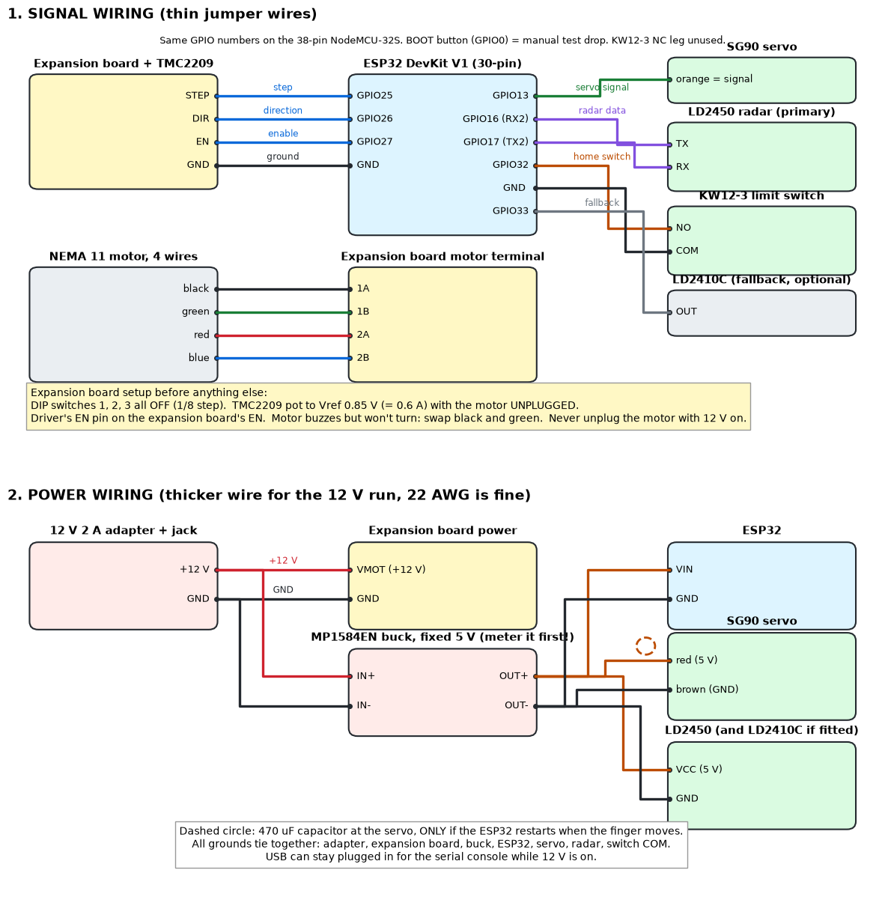

# 02 - Electrical

## Pin map, 30-pin ESP32 DevKit V1 (board in use)

Board: 30-pin ESP32 DevKit V1, ESP-WROOM-32 module, CP2102 USB chip, PlatformIO board `nodemcu-32s`. The 38-pin NodeMCU-32S uses the same GPIO numbers and works unchanged; go by the name printed beside each pin, not its position. The 5 V input pin is marked VIN on the 30-pin board and 5V on the 38-pin.

| ESP32 pin | Goes to | Direction | Notes |
|---|---|---|---|
| VIN | buck OUT+ (5.0 V) | power in | Do not feed 12 V here |
| GND (any) | common ground | - | All grounds tie together |
| GPIO27 | expansion board DIR, S row | out | Rewind direction set in firmware |
| GPIO26 | expansion board STEP, S row | out | One pulse = 1/8 motor step |
| GPIO25 | expansion board EN, S row | out | LOW = motor powered, HIGH = coils off (free) |

D27, D26, D25 sit side by side on the ESP32 header in the same order as the expansion board's DIR, STEP, EN columns, so one 3-wire ribbon goes across straight (changed 2026-10-01; before then STEP was GPIO25, DIR 26, EN 27).
| GPIO13 | SG90 orange | out | Not GPIO14: 14 pulses during boot and twitches the finger |
| GPIO33 | C4002 OUT | in | HIGH = someone there. Firmware adds a pull-down. Carries the trigger if the serial link goes silent, or always with `sensor 2410` (any active-high sensor) |
| GPIO32 | KW12-3 limit switch NO leg (COM to GND) | in | In the fairlead (doc 09). Pressed = bead lifting the flap. Firmware adds a pull-up |
| GPIO16 (RX2) | C4002 TX | in | Primary trigger, UART2 at 115200 baud |
| GPIO17 (TX2) | C4002 RX | out | Primary trigger: the firmware asks for a report every 0.1 s at boot |
| GPIO0 | on-board BOOT button | in | Press = manual test drop. Not on the 30-pin header; nothing to wire |
| GPIO2 | on-board LED | out | Slow blink = armed and ready |

## Driver: BIGTREETECH TMC2209 V1.3 on the A4988/DRV8825 expansion board

- Plug the driver in with its **EN** pin on the expansion board's **EN** position. Backwards destroys it on power-up.
- DIP switches 1, 2, 3 all **OFF**. On a TMC2209 that is 1/8 microstep (each STEP pulse moves 1/8 of a full step) and leaves the UART pin (the driver's serial setup line, unused here) alone. The board's switch numbers run backwards from the module's pins (owner's photo 2026-10-07): switch 1 sits under the module's RX pin (the A4988 MS3 position), switch 2 under MS2, switch 3 under MS1. Switch 1 ON ties RX to 5 V, which turns off the driver's standstill current cut (the runaway audit's fix 3). Switch 3 ON changes the microstep count and must stay OFF.
- Current: turn the driver's pot until the voltage from the pot's metal top to GND reads **0.85 V** (= 0.6 A, 90 percent of the motor's 0.67 A). Do this with 12 V on and the **motor unplugged**. Factory default is about 1.2 V, too high for this motor.
- STEP/DIR/EN only. UART is not wired; the expansion board does not bring that pin out.
- The expansion board's DIR, STEP and EN columns each have three pins, S, V, G. The ESP32 wire goes on **S** (signal). One wire from an ESP32 GND to any **G** (the G pins are all joined). **One wire from the ESP32's 3V3 pin to any V** (the V pins are the driver's logic supply input; corrected 2026-10-07, see below). Until that day the build left every V empty, and the driver's logic ran on leakage through its own signal pins.

## Power

| Rail | Source | Loads | Worst case |
|---|---|---|---|
| 12 V | 12 V 2 A wall adapter | driver/motor, buck input | about 0.6 A while rewinding (about 3 s per scare), about 0.05 A idle |
| 5 V | MP1584EN mini buck, fixed 5 V (not adjustable). Meter its output on 12 V **before** connecting anything | ESP32 (0.25 A peak, WiFi on), SG90 (0.7 A stall peak), C4002 (not stated by DFRobot: meter it at first power-up) | about 1 A peak; the MP1584EN is comfortable to about 1.5 A |

- 470 uF 16 V electrolytic across the servo's red and brown: **only if** the ESP32 restarts when the finger moves (the page's "Running for" clock resets). A micro servo moving for a fraction of a second on the buck's output does not normally need it. If fitted: at the servo end, stripe to GND.
- Idle draw between scares is a few watts at most: driver disabled, servo detached, radar and ESP32 on.
- The ESP32 browned out on PC USB and on a 2 A USB hub with the LD2450 attached (2026-10-07): bench the radar on the 12 V adapter through the buck, never on USB alone.
- USB can stay connected to a PC for the console while 12 V is on.
- Ceiling install: run 12 V up with a 5.5 x 2.1 mm DC extension cable. Keep the adapter at the outlet, never at the ceiling.

## Logic-level check (V1, required before first motor run)

**Corrected 2026-10-07, measured at the device:** the expansion board has no regulator. Its V row is the driver's logic supply input (the module's VIO), and with nothing on it the row read 2.7 V with the ESP32 wires on and 1.8 mV with them off: the chip's logic was fed only through the clamp diodes of its own STEP, DIR and EN pins. The TMC2209 needs 3.0 to 5.25 V there (datasheet rev 1.08). It is fed from the ESP32's 3V3 pin, not from 5 V: at 3.3 V the chip's high threshold is 2.3 V and every 3.3 V signal from the ESP32 is a clean high; at 5 V the threshold would be 3.5 V and the ESP32 could not reach it without the buffer below. Earlier text here said the board had its own 5 V regulator; it does not.

Test: with the motor connected, run `jog 1600` from the console. The motor must make exactly one smooth turn. Then `jog -1600`, one turn back.

If it stutters, misses, or does nothing while the driver clearly holds (shaft stiff): add a 74AHCT125 (or any 5 V buffer with 3.3 V-compatible inputs) powered from the 5 V rail between ESP32 and expansion board on STEP, DIR, EN. Wiring: ESP32 pin to buffer input, buffer output to expansion board, buffer enable pins to GND.

## Motor wiring

STEPPERONLINE NEMA 11, 11HS12-0674S (0.67 A, 5.6 ohm per coil): black (A+) + green (A-) = coil A, red (B+) + blue (B-) = coil B. Meter check: black to green and red to blue each read about 5.6 ohm; any other pair reads open. Black to 1A, green to 1B, red to 2A, blue to 2B. The leads come bare: put a female jumper end on each (half of a female-to-female jumper, joint soldered or twisted and covered, joints staggered) and push them onto the expansion board's motor pins. If the motor buzzes but will not turn, swap black and green. Never plug or unplug the motor with 12 V on.

## Limit switch wiring (KW12-3 in the fairlead)

The KW12-3 roller switch is built into the fairlead (doc 09). On rewind the stop bead lifts a hinged flap, the flap's tail presses the roller, and the firmware stops the motor the moment it closes.

Bare switch, three legs: **COM to GND, NO to GPIO32, NC unused.** No power wire. On the switch in hand, from the lever's hinge end the legs are COM, NO, NC (read off the part 2026-09-25). Meter check: the leg that beeps to one other leg at rest and to the third with the lever held is COM.

Open = HIGH, pressed = LOW with the firmware's pull-up. Check with the web page by lifting the flap by hand; if it reads backwards, `liminv 1`. Then `limit 1` turns it on. Keep the lead away from the motor wires, or twist its signal and ground together. Inverted install (doc 06): the switch and the radar sit under the base and the board on top, so their leads run round the base's far (servo) end, about 15 cm for the switch and 25 cm for the radar, tied clear of the spool.

By design the switch reads **open** at rest after the lock seat (doc 09, V14): the seat move lets the bead drop off the flap.

## Sensor wiring

**C4002 (primary, ordered 2026-10-07):** five pins on a 2.54 mm header, VIN, GND, RX, TX, OUT. VIN to the 5 V rail (3.6 to 5.5 V), GND, sensor TX to GPIO16, sensor RX to GPIO17, OUT to GPIO33. TX goes to RX and RX to TX: the sensor's transmit lands on the ESP32's receive. No cable comes with the board (bare holes, DFRobot photo): five dupont jumpers or a soldered 5-pin header. **OUT is wired, not optional:** it goes high while the sensor sees someone, and the firmware fires from it when the serial link has been quiet for 1 s (`sensor 4002`), or always (`sensor 2410`). The firmware needs both serial wires: it asks the sensor to report over GPIO17 at boot, and the sensor reports only once asked. Antenna face (two gold squares, pin names) toward the walkway. Mount: `cad/c4002_case.py` (`c4002_case_base.stl`, `c4002_case_lid.stl`) on the radar fork: antenna side down over the floor opening, so no PLA is in front of it (a 1 mm floor would cost about 6 to 10 percent of range by a flat-sheet calculation, 2026-10-10), pins toward the knuckle, wires out the 15 mm opening. Bench check: a person at 3 m, bare board then in the case.

**C4001 (on hand, `sensor 4001`), three questions answered 2026-10-08:**

- **Face against PLA: likely fine at 3 mm, bench to confirm** (corrected 2026-10-08; first answer said no). Plain PLA (dielectric constant about 2.75) is a weak absorber at 24 GHz; the loss is mostly reflection off the plate, by slab arithmetic about 0.8 dB round trip at 3 mm (about 5 percent less range) and about 2 dB at 2 mm (about 11 percent less, near the worst thickness, a quarter wavelength, 1.9 mm). The porch needs 3 to 4 m of an 11 to 12 m sensor. Unknown and only the bench can show: how much PLA touching the antenna detunes it. Waveshare's 24 GHz radome guide gives the ideal (6.2 mm gap, 3.75 mm thick, smooth, uniform, no metal or conductive coating). Plate: 3 mm, not 2, solid over the antenna (100 percent infill there), plain color, no silver, metallic or carbon-filled filament. Check: a person at 3 m read with `radar raw`, bare board then behind the plate.
- **Mode switch: UART.** DFRobot's SEN0610 wiki, UART example: "switch the DIP switch on the back of the sensor to the UART direction". I2C instead would mean wires to GPIO21/22, a register driver in place of the text-line parser, and a different `radar` console; not built.
- **Address switch: no effect in UART, leave it on 0x2A.** DFRobot's library uses the address only in its I2C class; the UART class takes a serial port and baud, no address.
- **Pins (SEN0610 wiki): four, `+`, `-`, `C/R` (RX in UART), `D/T` (TX in UART). No OUT pin.** `+` to 5 V, `-` to GND, `D/T` to GPIO16, `C/R` to GPIO17. GPIO33 stays empty, so this sensor has no OUT fallback if the serial link goes silent.

**OUT pin only (`sensor 2410`):** any sensor with an active-high output on GPIO33: the C4002's OUT, an LD2410C, a PIR, a step mat. 3.3 V or 5 V output both read; the pin has the firmware's pull-down.

**LD2450 (parked 2026-10-07):** 5 V, GND, TX to GPIO16, RX to GPIO17; red 5 V, black GND, yellow TX, green RX on the owner's cable. Three modules answered every command and never reported a target. The current firmware no longer speaks its protocol.
