# 05 - Print and assembly

Time: about 5 h printing, 1 h assembly. Tools: small Phillips, 1.5 mm and 2 mm hex keys (coupler set screws), multimeter, vise or bar clamp, CA glue, blue threadlocker, hair dryer.

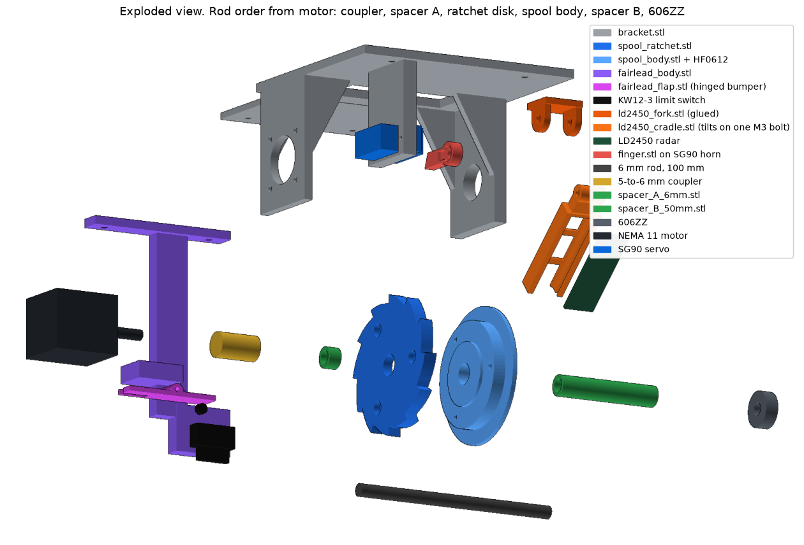

## A. Print

All PLA except the finger (PETG if you have it). Settings table in `01_mechanical_design.md`. Minimum set: 1 of each part. Spares worth printing: 1 extra finger, 1 extra flap. Shims only if step 8 calls for them.

## B. Sub-assemble the spool (Rev C.4: `spool_onepiece` plus `spool_cap`)

Two printed parts, no screws, no glue except the drop of CA on the line's knot. Doc 01 has the dimensions.

1. Press the **one-way bearing** (the clutch, the small 10 mm one with needle rollers) into `spool_onepiece` from the **far face** (the flat end at the barrel, away from the teeth), with a vise or clamp, until it stops on the printed shoulder. The hole is one plain diameter with no lip (the C.3 lip had to be carved out); it takes some force and holds tight (owner 2026-10-05), and spacer B bears on its far end through the cap's hole (step 9).
2. Check its direction now: push a spare piece of the 6 mm rod in, hold the rod, and spin the body. It must spin freely one way and lock the other. Mark the free direction on the separator (the disc between the teeth and the barrel) with a marker.
3. Look at the spool from the **teeth side** (this side faces the motor, so this is the view from behind the motor). The free direction marked in step 2 must be **clockwise** from this side, so it locks counterclockwise (Rev C.1; Rev C had this backwards). If not, press the bearing out and flip it.
4. Anchor the line **before the cap goes on**: the cap closes the far ends of the spoke windows. The line is **bonded nylon upholstery thread, size 69 (Tex 70), black** (owner 2026-10-04; 0.29 mm, 11 lb). The 1.2 mm line hole is printed in, mid-barrel, between two spokes. Push the thread in from outside, fish it out of the window's open end, tie it round a 10 mm stub of 1.75 mm filament (a double overhand), and pull it back so the stub lies across the hole inside the window. A drop of CA on the knot. The stub cannot pull through the hole, so the line cannot slip round the barrel even if the spider runs the line out.
5. Fit `spool_cap`: its three lugs into the three spoke windows (a snug drop-in; a stroke of a file on a lug's side if one will not go), which lines its three holes up over the pilots in the spokes, then drive **3x M3x8** through it into the body. Snug, do not strip; the cap must sit flat on the body with no gap at the barrel's edge anywhere round (that gap is where a thread would wedge). If there is one, back the screws off, scrape any lip off the hole edges, and tighten again. Then wind clockwise (seen from behind the motor), under light hand tension so the wraps lie tight, the first turn over the line's tail. Wind on about 1.5 m of spare first (two drops' worth, owner 2026-10-04): about 10 turns, under one layer on the 3.5 mm barrel, so the drop length changes by about 1 percent. If the line breaks, unwind the spare and retie. Set `line` to the working length only (the barrel to the bead), as if the spare were part of the barrel. No elastic, no braid. The window ends on the motor face stay open, so the anchor can be reached there with the cap on.

## C. Frame and rod

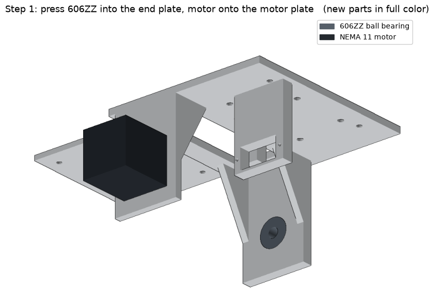

6. Press the **606ZZ** into the end plate. If it goes in loose (a seat softened by heating the bearing, or an older bracket), fit `bearing_retainer` on the end plate's outside face: drill two 2.5 mm pilots through the end plate using the retainer's holes as the guide, then 2x M3 x 6 to 8. The rod passes through its 12 mm hole and sticks out past it by about 14 to 17 mm; that is expected. Screw the **NEMA 11** to the outside of the motor plate, 4x M2.5x6, wires pointing toward the base.

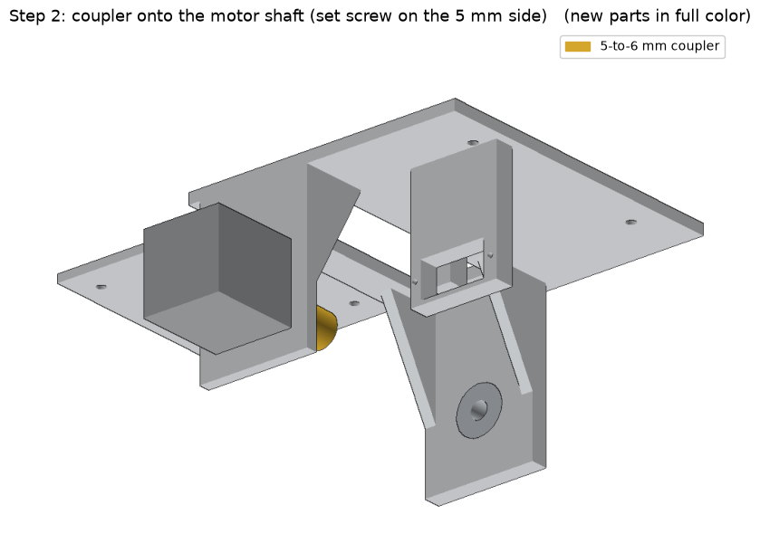

7. Slide the **coupler** onto the motor shaft, 5 mm side, until the shaft stops. Blue threadlocker, tighten that set screw. Leave the 6 mm side loose.

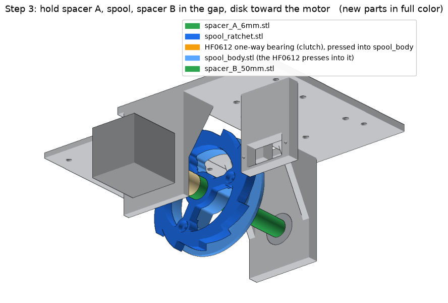

8. Measure from the motor plate's outer face to the free end of the coupler. **30 mm:** use `spacer_A_6mm`. **26 mm:** use the old 10 mm spacer A if you have one. **27 to 29 mm:** `spacer_A_6mm` plus `shim_1mm` / `shim_2mm` to make up the difference. **Over 30:** sand spacer A down by the difference. With the one-piece spool, `spacer_A_nose_7_5mm` replaces spacer A and its shims (doc 01).
9. Hold, in line inside the frame: `spacer_A_nose_7_5mm` (next to the coupler, nose toward the spool), the spool (teeth toward the motor, cap toward the 606ZZ), `spacer_B_50mm` and its shims. **Owner's build, Rev C.4, as a change from the C.3 one-piece stack:** motor side unchanged; 606ZZ side, **keep the C.3 stack as it is, no shim out**: spacer B passes through the cap's 11 mm centre hole and bears on the one-way bearing's far end, not the cap (owner 2026-10-05), so spacer B and its shims fill 53.36 mm against the 53.0 there, 0.36 mm of play, under the 0.5 allowed. Look at the bearing's far end first: the steel rim should be the highest thing there; if the black cage inside stands proud of it, say so before the stack goes on (spacer B would rub the cage). A cap printed with the old 7 mm hole: open it to about 11 mm with the deburring tool. If the 2026-10-04 stopgap is fitted (the old `spool_shield` disc on the far side plus a 2 mm shift shim), take both out. On another frame, stack snug but not tight the same way. Then check the teeth still sit between the finger's faces.

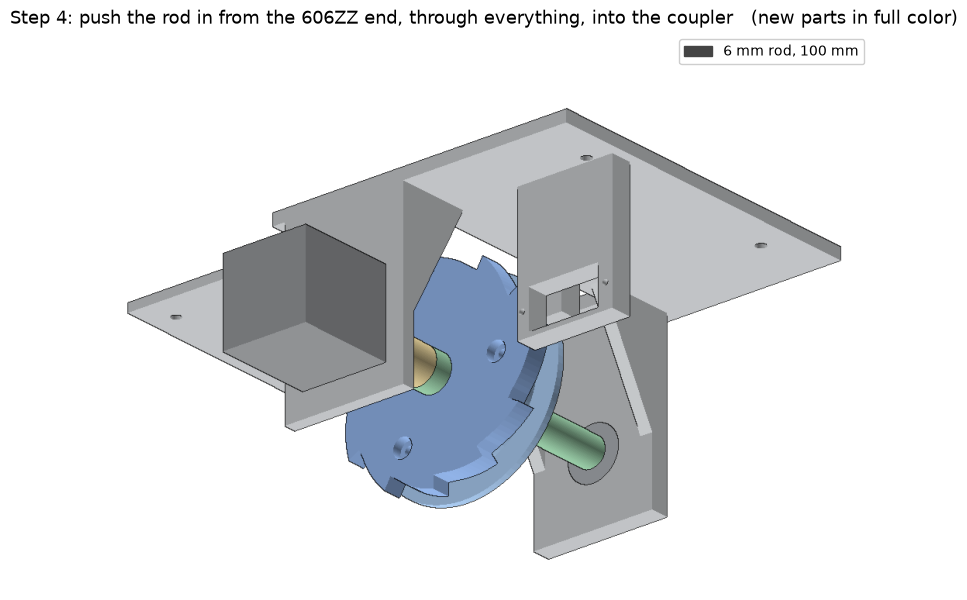

10. Push the **6 mm rod** in from the outside of the 606ZZ plate: through the bearing, spacer B, spool (rotate the spool its free way as the rod enters the needles), spacer A, into the coupler until it bottoms. Blue threadlocker, tighten the 6 mm set screw.
11. Check: the spool spins freely by hand clockwise (seen from behind the motor), and turning it counterclockwise drags the motor shaft round with it. The stack is snug with no end play above 0.5 mm.

## D. Servo and finger

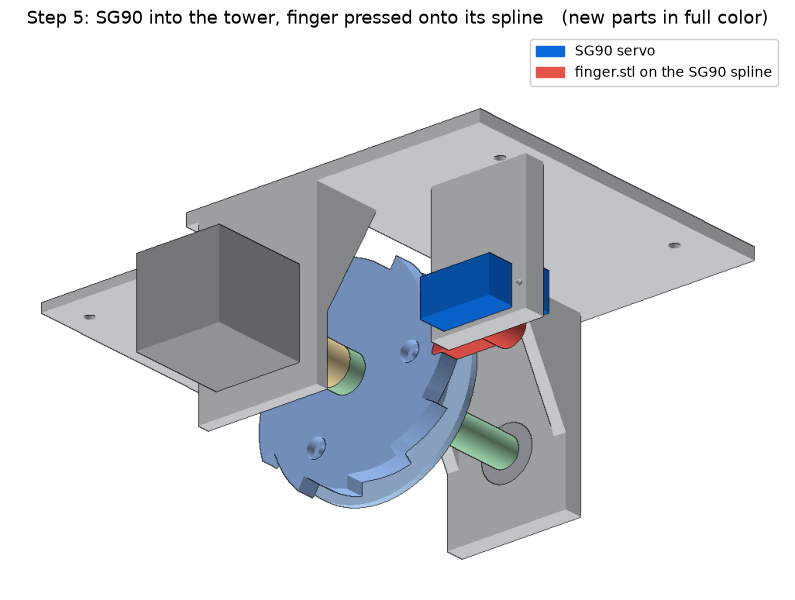

12. Drop the **SG90** into the tower pocket from the 606ZZ side, output spline toward the spool, wires out the far end. Two tab screws.
13. Power the servo (or do this at commissioning): send it to 90 degrees. No horn is used.
14. Press the **finger's hub** straight onto the servo spline, pointing at the rod, level, resting just above the ledge, tip in the teeth. The socket is round, so it goes on at any angle. Push until the spline bottoms in the socket, then drive the horn screw in from the top, down the 7.4 mm recess. If it is loose on the spline, a drop of CA in the socket; if too tight to push on, turn a 5 mm drill through the socket by hand. Check edge-on: the 7 mm finger covers the ratchet teeth; at least 5 mm must overlap. The finger printed from 2026-10-02 on has a hub 2.5 mm shorter, so it sits 2.5 mm nearer the servo: move 2.5 mm of shim from the motor side of the spool to the 606ZZ side. If not, move the disk with spacer A and the shims (step 8).

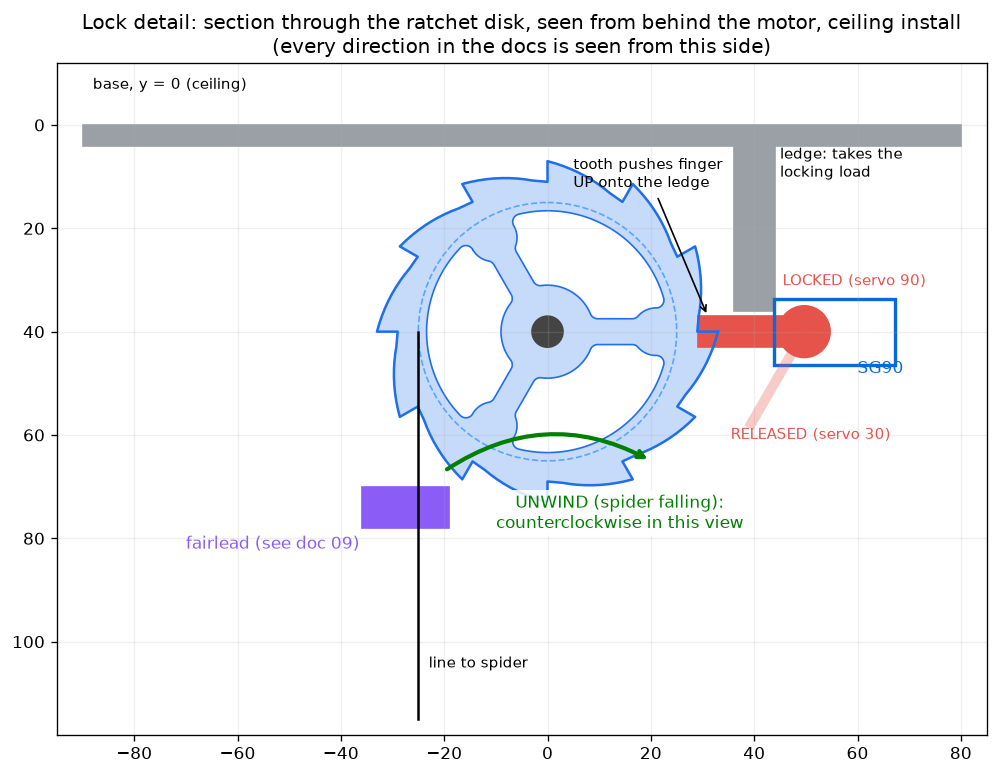

## E. Fairlead, limit switch and line

One `fairlead_body` and one `fairlead_flap` per build. Full detail in `09_fairlead_switch.md`.

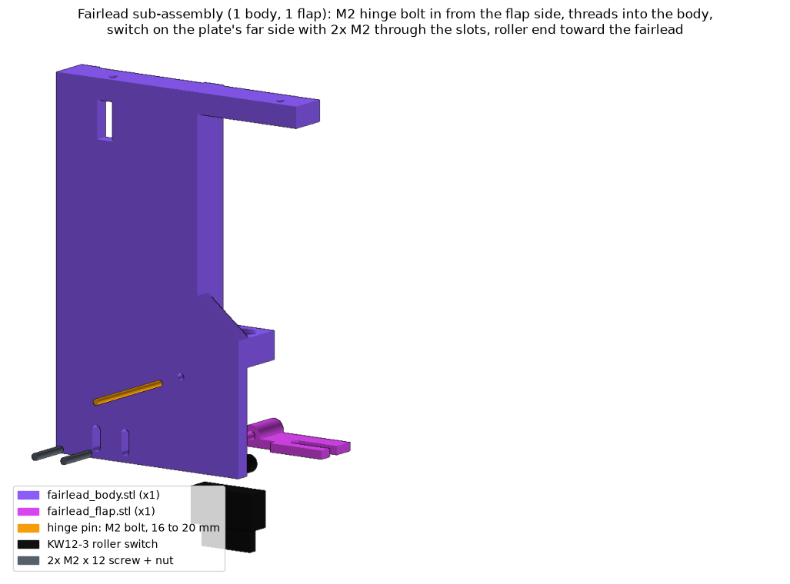

15a. Clear the fairlead bore with a 3 mm drill turned by hand. A scrap of the line must slide through without catching.
15b. KW12-3 switch onto the switch plate: roller end toward the fairlead, body on the side away from the flat back. 2x M2 x 12 through the slots, nuts on the switch side, finger-tight.
15c. Flap knuckle into the gap under the fairlead. Hinge pin: an **M2 bolt, 16 to 20 mm**, in from the flap's outer side: free through the flap (open the flap's hole with a 2.5 mm drill by hand if it drags), then it cuts its own thread into the body's hole. Stop before the head clamps the flap. Check the flap swings down under its own weight.
15d. Flap level on its rest stop: slide the switch up until the roller just touches the flap's tail, back off a paper's thickness, tighten. Lift the flap's free end by hand: click at about 2 mm, then it stops flat against the fairlead.

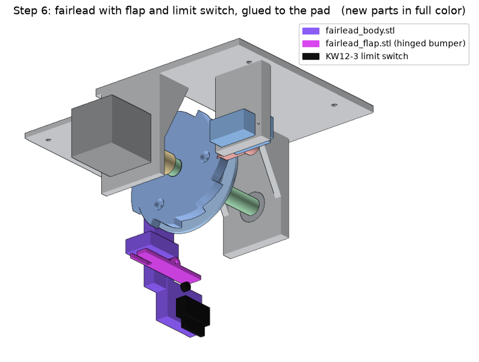

15. Screw `fairlead_body` to the pad: 2x **M3 countersunk (flat-head) screws, 8 to 10 mm**, put in from the ceiling side down through the x = -32 pad holes, heads flush with the ceiling face, cutting their own thread into the fairlead's rail (2.5 mm pilots). No glue (owner 2026-09-26). The pad holes need a 90 degree countersink so the heads sit flush: new bracket prints have it; on an already printed bracket, twist an 8 mm drill bit by hand in each of the two holes from the ceiling side until a screw head sits flush or just below.
16. Wind the line onto the spool by turning it clockwise (seen from behind the motor). The free end leaves the spool on the pad side; thread it down through the fairlead, then slide it into the flap's slot from the flap's free end.
17. Below the flap, in order: **8 mm bead** (slides on the line; this is what lifts the flap), **barrel swivel** (tie the line to it with an improved clinch or palomar knot; the bead rests on it), **spider** tied to the swivel's other end. The spider is brought to about **30 g** (owner 2026-10-04: weight added inside the 13 g foam spider, so the wraps lie on the barrel at about twice the tension); keep it under 60 g until the bench says more.
18. Unwind fully and measure from the barrel knot to the bead, line straight but not pulled. That is the `line` value for the firmware.

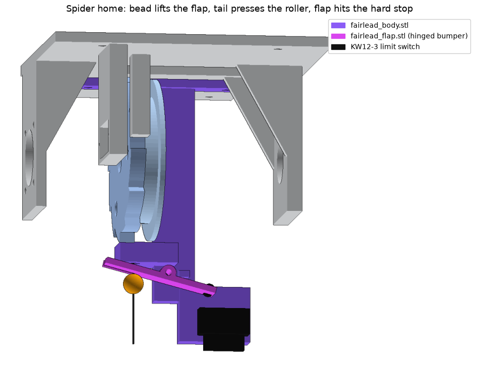

## F. Electronics

19. Meter the 5 V buck (MP1584EN, fixed, not adjustable): 4.95 to 5.05 V before connecting any loads.
20. Set the TMC2209 Vref to 0.85 V, motor unplugged. DIP switches all OFF.
21. Wire per `02_electrical.md` (LD2450 on GPIO16/17, KW12-3 NO to GPIO32 and COM to GND). Mount the controller board on the pad with foam tape or zip ties through the x = -80 holes. Keep the x = -56 holes and the two at the servo end clear: they are the ceiling screw holes.
22. Go to `07_commissioning.md` before mounting anything overhead.

## G. Inverted install only (device turned over on the beam's face, doc 06)

23. Bracket printed from 2026-09-28 on: the five holes are already there, skip to 24. Older print: drill the base: 7 mm at x 25, z 45 (the line; a 1/4 in bit is close enough), 3.4 mm at x 32, z 28 and z 83 (the fairlead block), and, on every print, 3.4 mm at x -80, z 38.5 and z 72.5 (the radar fork at the pad end; the owner's build has the servo end at the beam, 2026-10-01). Print `cad/bracket_footprint_inverted.svg` at 100% as a template. Sand the 7 mm hole smooth. The brace bolt holes are the owner's; doc 06 says where they can go.
24. Print `fairlead_base.stl` instead of `fairlead_body.stl`. Fit the flap and switch to it as in steps 15a to 15d, then screw it under the base with 2x M3 x 12 from inside the base.
24a. Optional, PTFE guide tube, trial first with no print (owner 2026-10-04; doc 09): from inside the base, push a piece of 4 mm PTFE tube (the 3D printer kind, 2 mm bore) down through the 7 mm line hole into the block's tapered mouth until it wedges; the line's pull on the drop seats it deeper. Its tip must end **11 mm above the base's inner face** and no higher (any higher and it hits the spinning cap): mark it there, take it out, cut at the mark, push it back.
24b. Only if the wedged tube walks or wobbles: print `fairlead_base_ptfe.stl` instead of `fairlead_base.stl` (straight bore, a snug push fit, no lightening windows), fit it the same way, and push a **41 mm** piece of tube in until its end is flush with the block's underside; the tip then sits 11 mm above the base's inner face.
25. Bolt `c4002_case_short_mount.stl` under the base at the pad end, on the x -80 holes, plate against the base, ears hanging down: 2x M3 x 10 up through the fork and the base, nuts inside. No glue. Cradle on one M3 bolt through the fork's ears, radar slid into the cradle (doc 03), looking along the device toward the beam (the servo end) and down, 50 degrees to start. The nuts sit inside under the board's edge: keep that strip clear or lift the board on 4 mm foam tape.
26. Wind the line clockwise (seen from behind the motor) as in step 16, but lead it off the spool's **servo side**, down through the base hole (through the PTFE tube if fitted), the block's bore and the flap's slot.
27. Leads: the switch and radar leads go round the base's pad end and back to the board (about 15 and 10 cm), tied to the base clear of the spool.
28. The braces and their holes are the owner's. Then `07_commissioning.md` as usual.

## Base layout reference

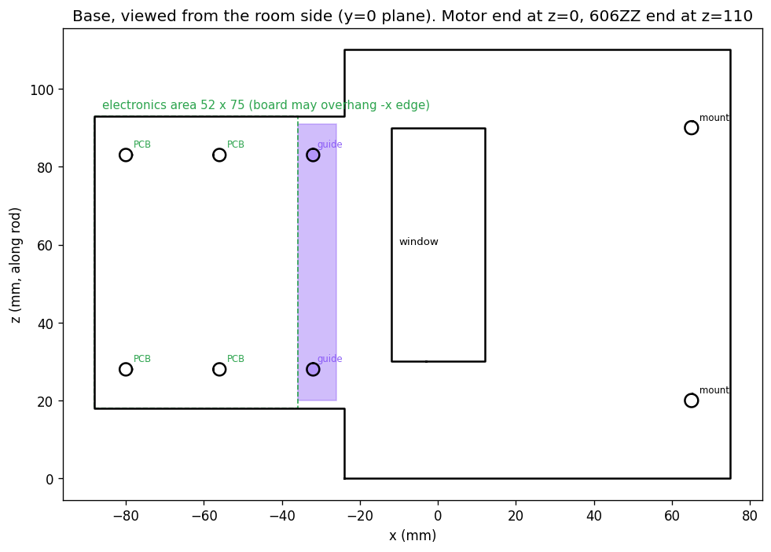
